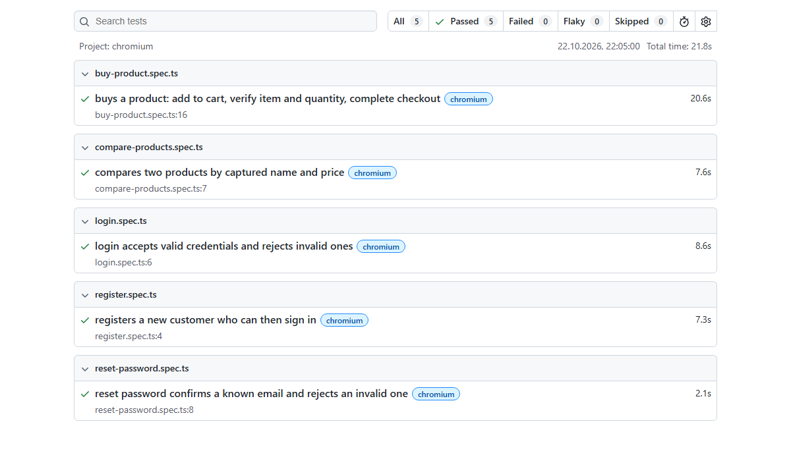

# Review of AI-Assisted Work (SIS 2)

This document records how AI was used, what it produced, what went wrong, and what was reviewed and changed. Statements are attributed: "the AI" means Claude Code (see `Prompt.md`), "I" means me, the student. I reviewed all the code and checked the behavior manually on the live site. Items I could not state precisely are marked **[ADD YOUR RESULT HERE]**.

## 1. What the AI generated

| File | Content |
|------|---------|
| `playwright.config.ts` | Base URL, `testIdAttribute: 'data-test'`, Chromium project, `fullyParallel`, retries only on CI, trace on first retry |
| `pages/*.page.ts` | Page objects: base, login, account, register, home, product, cart, checkout, forgot-password |
| `fixtures/pages.fixture.ts` | One fixture per page object, `expect` re-exported |
| `data/user.factory.ts` | `NewUser` interface and `UserFactory.create()` with a UUID-based unique email |
| `tests/*.spec.ts` | Five spec files, one per test case |
| `package.json`, `tsconfig.json`, `.gitignore`, `README.md`, `Description.md` | Project setup and documentation |

## 2. Assumptions the AI made

The AI wrote all page objects without opening the live website. It guessed:

- every `data-test` value, route and post-registration behavior (redirect to the login page);
- the registration form fields, the date-of-birth format and the country option value;
- the checkout step order and payment option;
- product names (`Combination Pliers`, `Claw Hammer`) and that they were in stock;
- the reset-password success and error elements;
- that the seeded account `customer@practicesoftwaretesting.com` could be reused freely.

All guesses were marked `TODO_VERIFY` in the code, as I had asked in the prompt.

## 3. First execution: tests failed

The first full run of `npx playwright test` ended with **5 failed**. The causes, found by inspecting the live site:

| Test | Failure | Cause |
|------|---------|-------|
| register | Stayed on `/auth/register` instead of `/auth/login` | The form has a required `house_number` field that the page object did not fill |
| login | Valid login stayed on `/auth/login` | The seeded account was locked ("too many failed attempts"). The AI's own invalid-login test had used the wrong password on that same account repeatedly |
| buy-product, compare-products | Strict mode violation, locator matched 2 elements | The product-card locator `[data-test^="product-"]` also matched `product-name` and `product-price` elements. "Combination Pliers" was also out of stock |
| reset-password | `forgot-password-success` not found | The success message has no `data-test`; it is a `role="alert"` element |

## 4. Selectors and data-test values I verified manually

The AI helped find the real values: it inspected the live pages with a script that read the actual `data-test` attributes and routes. I then confirmed them independently on the running application through codegen and browser DevTools (see below the table).

| Area | Verified values |
|------|-----------------|
| Login | `email`, `password`, `login-submit`, `login-error`; route `/auth/login`; after success `/account` |
| Register | `first-name`, `last-name`, `dob`, `country` (select, value `US`), `postal_code`, `house_number`, `street`, `city`, `state`, `phone`, `email`, `password`, `register-submit`; redirect to `/auth/login` |
| Header | `nav-menu` (shows the user's full name), `nav-cart` |
| Catalogue and product | `product-name` (on cards and on the product page), `unit-price`, `quantity`, `add-to-cart`, `out-of-stock`; alert "Product added to shopping cart." |
| Cart and checkout | cart is on `/checkout`; `proceed-1`, `proceed-2`, `proceed-3`, `payment-method` (value `cash-on-delivery`), `finish`, `payment-success-message`; final text "Thanks for your order! Your invoice number is INV-…" (no `data-test`) |
| Reset password | `forgot-password-submit`, `email-error`; the success alert has no `data-test` (`role="alert"`); route `/auth/forgot-password` |

How I confirmed them myself, independently of the AI's script: I ran `npx playwright codegen https://practicesoftwaretesting.com --test-id-attribute=data-test` and went through each scenario by hand (registration, login, product, cart and checkout, password reset). I compared what codegen showed with the locators in `pages/`, at least one element per page (for example `login-submit`, `email-error`, `house_number`). I found no discrepancies. I also looked in browser DevTools for a `data-test` on the successful-order message and confirmed that it has none, so the test asserts the invoice text instead.

## 5. Errors and weak decisions found

**In the AI's code (found in review before the first run):**
1. No `package.json`, `tsconfig.json` or README, so `npm install` and `npx playwright test` could not work. Added.
2. `npm install` does not download browsers. Added `postinstall: playwright install chromium` and `@types/node`.
3. `login.spec.ts` and `reset-password.spec.ts` each had two `test()` blocks (7 in total). Reduced to five, one per spec, using `test.step()` for the two scenarios.
4. `HomePage.openProductAt(index)` used a positional `.nth()` and was unused. Removed.
5. Redundant assertion in `compare-products.spec.ts`. Removed.

**Found after executing against the live site:**
6. The failures in section 3.
7. **Stock is finite and shared.** Repeated parallel runs of the purchase test exhausted the stock of "Pliers" (the quantity field became disabled). A fixed product makes the test fragile.
8. **Intermittent HTTP 422 on order creation.** The order API answered "The billing_country does not match the entered address. The city does not belong to the selected country." intermittently, even for a real address, and more often when several orders were placed at once. Re-typing the prefilled billing fields made it worse.
9. A race in the buy test: it navigated away before the login had finished, so checkout showed the login form instead of the signed-in step.
10. The confirm click could happen before the button switched from "Check payment" to "Confirm".

**Weak points that remain:**
- The compare test partly compares numbers it has just captured. The assertions that can fail are the product names, the positive prices and "prices differ".
- The reset-password success alert shows a raw translation key (`page.forgot-password.confirm`) instead of a message. The test only asserts that the alert is visible, not its text.
- The checkout page object retries the "Confirm" click to survive the server's intermittent 422. This is a workaround for the backend, not a feature of the app.
- The reset-password test uses the shared seeded email, but it only requests a reset.

## 6. What was changed and why

| File | Change | Reason |
|------|--------|--------|
| `pages/register.page.ts`, `data/user.factory.ts` | Added the `house_number` field and `houseNumber` data | Form validation failed without it |
| `data/user.factory.ts` | Real address (Broadway, New York, NY, 10001) instead of invented values | Checkout validates that the city belongs to the country |
| `pages/home.page.ts` | Removed the `[data-test^="product-"]` locator and `openProductAt`. Product is selected by exact name via `getByTestId('product-name')`; added `openFirstInStockProduct(names)` | Strict-mode violation, no positional or CSS-style selector, stock changes |
| `tests/buy-product.spec.ts` | Candidate list of products, first in stock is bought. Waits for the account page after login | Finite shared stock; fixes the navigation race |
| `pages/checkout.page.ts` | Only the missing house number is filled; waits for the prefilled address; waits for the "Confirm" button; retries confirm with `toPass`; asserts the invoice text | Intermittent 422 and the confirm race, final assertion must prove the order |
| `tests/login.spec.ts` | Registers its own user; invalid login uses that user with a wrong password; valid login also asserts the signed-in name | The seeded account was locked by failed attempts. A shared account must never receive failed logins |
| `pages/forgot-password.page.ts` | Success uses `role="alert"`; the error check also asserts `aria-invalid="true"` and no success alert | Real markup of the page; stronger rejection check |
| `pages/*` | Removed all `TODO_VERIFY` markers after verification | Values are now confirmed |
| `README.md`, `Description.md` | Updated limitations and status | They described the old state |

**Deviation from the assignment text:** I was told to use the seeded account for login. That account became locked, so the login test uses a freshly registered user instead. This is more robust, and the reason is documented here and in the README.

## 7. How meaningful assertions were verified

- The first run proved that the assertions can fail: registration failed `toHaveURL(/auth/login)` while the page stayed on `/auth/register`; the valid-login check failed while the account was locked; the reset-password check failed on the wrong element.
- Each test asserts an observable outcome of the requirement:
  - register: redirect to login, then a successful sign-in with the same credentials and the user's full name in the header;
  - login: error visible and account page not reached for a wrong password; account page and full name for the right one;
  - buy: the product name, the quantity 2 in the cart row, and the invoice number text after checkout;
  - compare: names match what was requested and differ, prices are positive and differ, the ordering is consistent;
  - reset password: an alert for a known email; the email error, `aria-invalid="true"` and no success alert for an invalid one.
- My own check that these assertions fail when the behavior is wrong. For each test I broke one expectation on purpose, ran only that spec (`npx playwright test tests/<name>.spec.ts`), confirmed it went red, and reverted the change:

| Test | What I broke | Result |
|------|--------------|--------|
| register | In `expectRegistrationSucceeded` changed `/auth/login` to `/account` | failed |
| login | Valid step used the password `${user.password}-x` | failed on `expectLoaded` |
| buy | Changed `QUANTITY` in `cartPage.expectItem` to 3 | failed |
| compare | Set `PRODUCT_B_NAME = PRODUCT_A_NAME` | failed on "names differ" |
| reset | In `expectEmailRejected` expected `toHaveCount(1)` for the alert | failed |

All changes were reverted afterwards and the suite is green again.

## 8. Independence and parallel execution

- By design: every test gets a fresh browser context; registration, login and checkout each use a newly generated user with a UUID-based email; products are selected by name; no test asserts the catalogue size; the specs share no state.
- During AI-assisted development, the suite was executed several times in a row with default workers and with `--workers=5`. After the final fixes it passed 5 of 5 in five consecutive runs, and three purchases run concurrently also passed. The most recent AI run was `5 passed (16.8s)`, with `npx tsc --noEmit` clean. I then independently reran the final suite myself and reviewed the results (see my own runs below).
- The same repeated parallel runs, before the fixes in section 5, exposed the instability from points 7 and 8. That is how those problems were found.
- Side effect to be aware of: the repeated runs placed many real orders on the shared demo site and used up the stock of one product.
- My own runs, to check independence and parallelism:
  - `npx playwright test --workers=1` (sequential) and `npx playwright test --workers=4` (parallel);
  - each spec alone, for example `npx playwright test tests/login.spec.ts`;
  - `npx playwright test --repeat-each=2`, where both repetitions passed;
  - files in reverse order, for example `npx playwright test tests/reset-password.spec.ts tests/register.spec.ts`.
  I did not repeat the purchase test dozens of times, because every run places a real order and uses up the shared stock. Two or three runs were enough.

## 9. Code check against the assignment rules

- `npx tsc --noEmit`: no errors.
- Search in `tests/` for `getByTestId`, `locator(` and `waitForTimeout`: no matches.
- Search in `pages/` for CSS classes, XPath and `.nth(`: no matches (the only hits for `//` are comments).

## 10. Run results

Final run of the whole suite (`npx playwright test`, 4 workers, Chromium): **5 passed (21.8s)**. Raw console output is in [`results/run-output.txt`](results/run-output.txt), and a screenshot of the HTML report is below.

## 11. Final status

All five tests pass on the live site after the changes described above. The suite depends on a public demo whose stock, accounts and address validation I do not control, so occasional failures are possible. This is stated in the README under "Known limitations".
